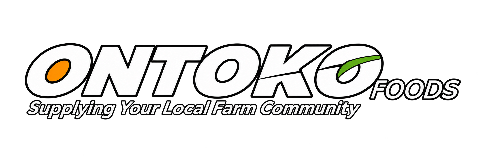
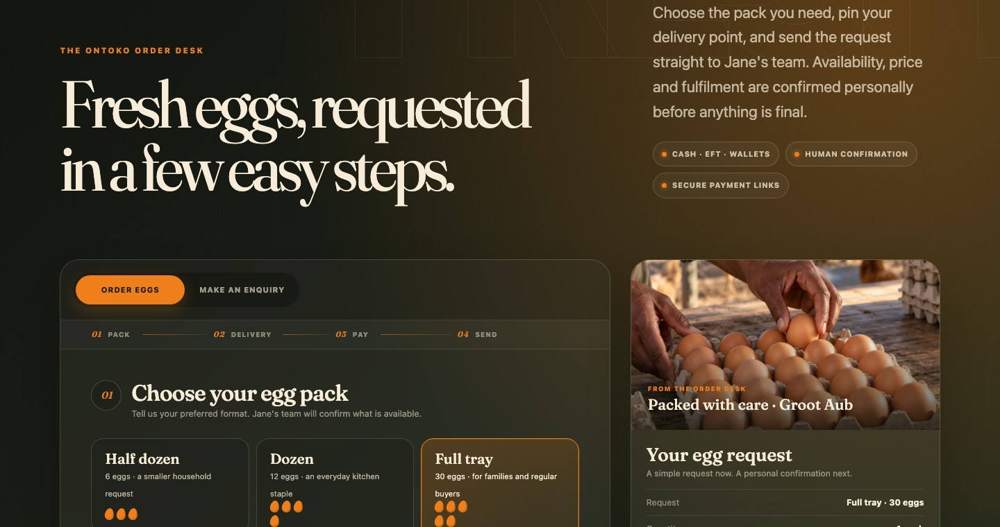
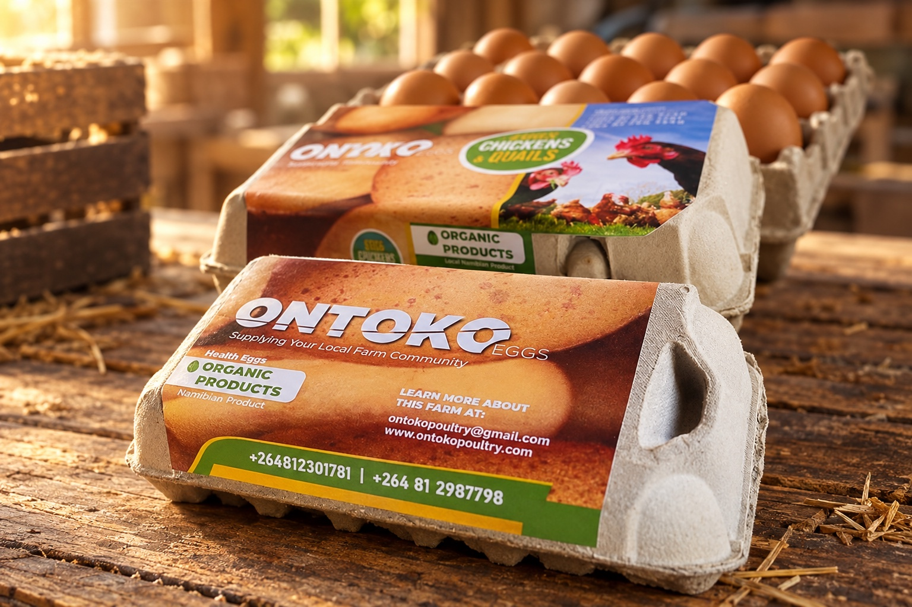
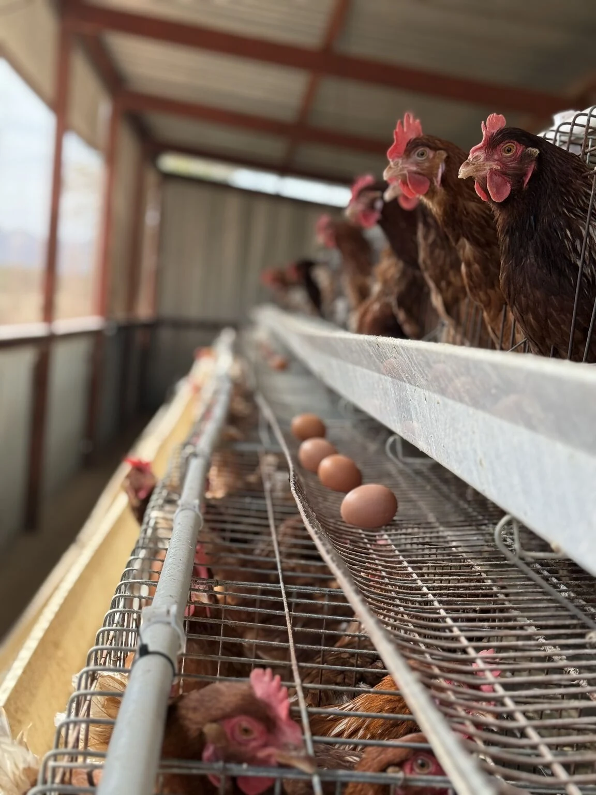
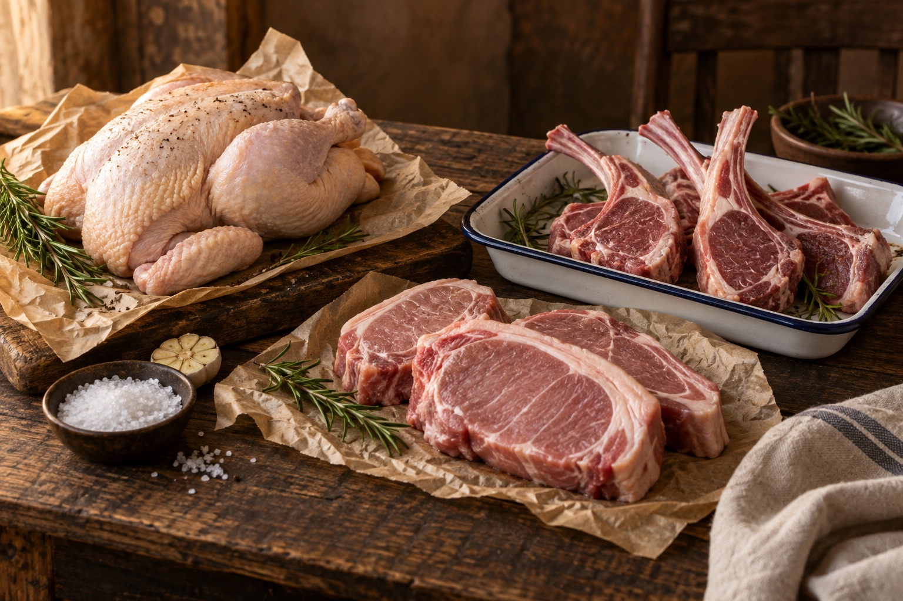
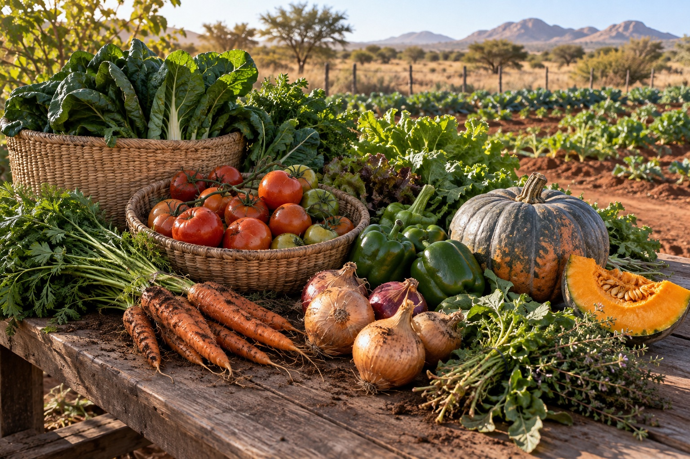
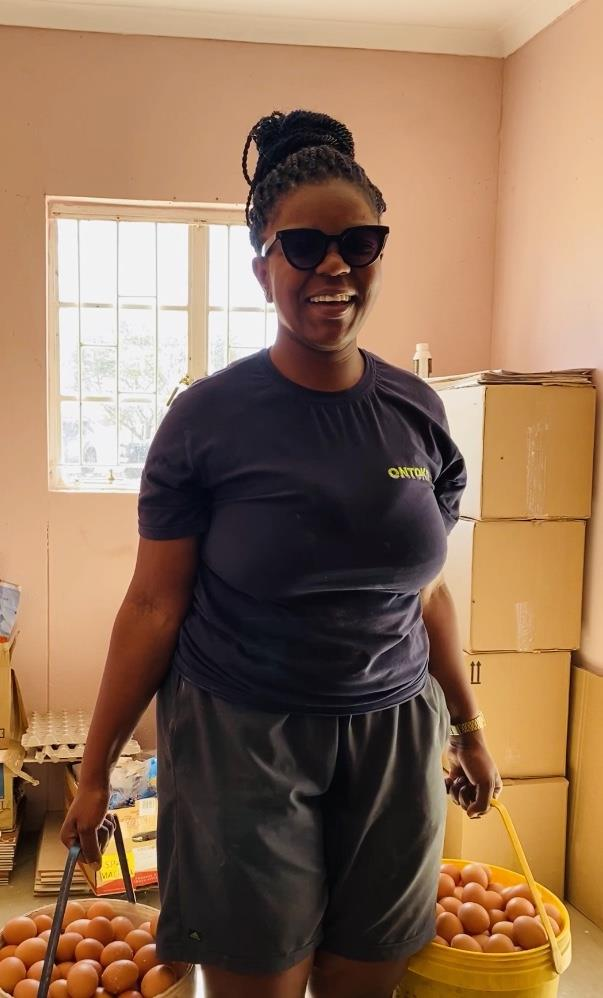
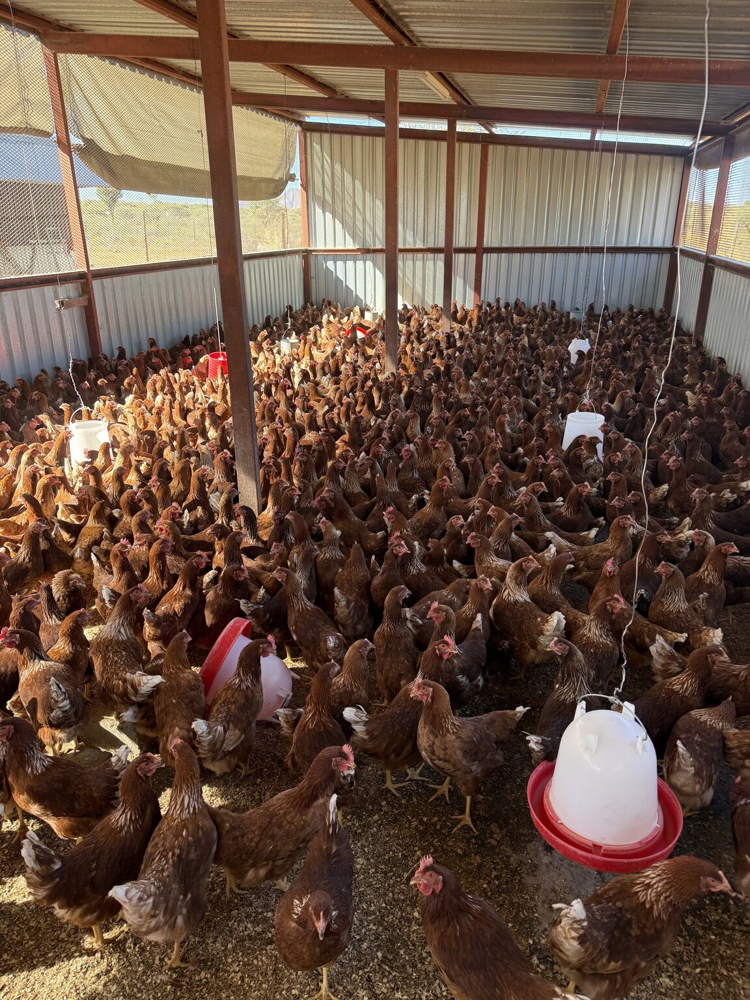

  

  

# Ontoko Foods — Feeding Home

**[Visit the live website](https://ontoko-foods.pages.dev/)**

Ontoko Foods is a woman-led Namibian agricultural business built by Jane Auala and her family near Groot Aub. From a small household poultry operation, Ontoko has grown into a local food producer supplying eggs, poultry, meat and seasonal produce while contributing to food security, farmer knowledge and women's leadership in agriculture.

This project gives that journey the digital presence it deserves: unmistakably Ontoko, grounded in real evidence and ambitious enough to match the business Jane built brick by brick.

## The brief

Ontoko had a recognisable product identity, public coverage and a strong founder story, but no owned digital home connecting them. The website needed to feel like a natural extension of the cartons, farm and social presence—not a generic agriculture template. It also needed to speak equally well to households, retailers, wholesale partners and future collaborators.

## What shipped

- A premium, mobile-first website shaped around Ontoko's existing identity
- A faithful digital adaptation of the Ontoko logo and packaging language
- Clear presentation of eggs, poultry, farm meats and seasonal produce
- A founder-led story tracing Jane Auala's journey from family farm to growing enterprise
- A source-grounded timeline from the farm's beginnings to the 2026 flock expansion
- Authentic Ontoko archive photography, recent farm evidence and carefully restored supporting imagery
- An interactive then-to-now reveal that makes the growth tangible
- Embedded audio so visitors can hear Jane describe the journey in her own voice
- A privacy-enhanced, click-to-play version of Jane's official Standard Bank growth story that does not contact YouTube until a visitor chooses to watch
- Direct egg-order requests and general enquiries with a WhatsApp fallback
- Optional return-client details saved only on that customer's device
- OpenStreetMap delivery pinning, nearby-area suggestions and visible attribution
- A protected admin corner where Jane can review, export and move requests through fulfilment
- Cash ordering now, with OneGate-hosted EFT / Pay by Bank, Google Pay and Apple Pay readiness held behind merchant activation
- An installable Progressive Web App with offline fallback, app shortcuts and platform icons
- Cloudflare Pages Functions and an isolated Workers KV order store
- Accessible motion, reduced-motion support, responsive layouts down to 320 pixels and hardened Cloudflare security headers

## From story to a working order desk

The website now carries the customer journey beyond inspiration. A household can choose an egg pack, select collection or delivery, pin the delivery point, record a payment preference and send a structured request directly to Ontoko. The order summary remains visible without becoming a second scrollable page, and every step is recomposed for narrow mobile screens.

  

Jane's protected order desk completes the operational loop with review, fulfilment status, exports, confirmed totals and verified payment-state handling. Public screenshots deliberately exclude customer records, phone numbers, addresses, delivery coordinates, credentials and merchant configuration.

## Live commerce boundary

Cash requests and enquiries are live. Every order still depends on Ontoko confirming stock, price and fulfilment personally; this is not instant or automatically confirmed ecommerce.

The hosted checkout workflow is prepared for EFT / Pay by Bank, Google Pay and Apple Pay through OneGate, but live online processing remains activation-gated until Ontoko receives its own payment-capable merchant organisation and confirmed settlement configuration. The website never receives or stores card numbers, bank passwords or wallet credentials.

## From product list to product appetite

The range originally risked reading like four coloured information panels. The final system treats every category as something visitors should be able to see and almost feel: authentic Ontoko cartons, healthy poultry, tactile farm meats and an abundant seasonal harvest. The four photographs share one warm Namibian light, one earthy grade and one editorial standard, while the interface preserves strong text contrast and natural mobile crops.

<table>
  <tr>
    <td width="50%"></td>
    <td width="50%"></td>
  </tr>
  <tr>
    <td width="50%"></td>
    <td width="50%"></td>
  </tr>
</table>

The renewed farm imagery is evidence-led: the current laying line, packed product, delivery vehicle and founder photography come from Ontoko's own archive or Jane's public business record. Jane's established photograph with the eggs remains part of the story, while a second professional portrait broadens the founder presentation without replacing it.

Flat colour fields across the wider site were rebuilt with paper grain, agricultural contour lines, photographic depth, warm light and oversized background typography. Mobile is not a compressed desktop afterthought: crops, type scales, tap targets, safe areas and interaction states are deliberately tuned down to 320px.

## Design direction

The visual system starts with the brand already on Ontoko's cartons: yolk orange, farm green, warm cream, earth brown and a bold black ground. **Fraunces** brings a human, editorial voice to Jane's story; **Manrope** keeps product and action language clean and contemporary.

Large type, harvest-scale photography and tactile bento cards give the business confidence. Rounded details and warm copy keep it generous. The opening logo sequence feels less like a generic spinner and more like Ontoko itself arriving on screen.

The guiding line became:

> Food made to feed home.

## Founder story as product architecture

Jane's story is not an appendix. It is the emotional spine of the experience. The site moves from produce to purpose, then from personal determination to visible business growth. That structure helps visitors understand that buying from Ontoko supports a local food system, a family enterprise and a woman creating opportunity through agriculture.

<table>
  <tr>
    <td width="42%" valign="top"></td>
    <td width="58%" valign="top"></td>
  </tr>
</table>

  

Jane's official Standard Bank growth film is embedded behind a designed consent-first facade. The YouTube player loads only after a visitor presses play, then unloads completely when closed, preserving the site's initial performance and privacy posture.

## Authenticity by design

The research layer brought together Ontoko's public archive, founder posts, Namibian media coverage, programme recognition and Jane's own recorded interview. Facts on the site were written from traceable sources, while real Ontoko imagery anchors the visual story.

That grounding matters. The aim was never to make Ontoko look like somebody else's idea of a premium farm—it was to reveal the quality, grit and momentum already there.

## Product boundary

This repository is a public case study. Production source, original high-resolution media, customer and order records, delivery locations, admin access, merchant secrets, deployment configuration and private working files remain in a separate private repository. Brand and photographic assets shown here belong to their respective owners and are not licensed for reuse.

## Role

Public-source research · story architecture · brand translation · art direction · product and service design · UX/UI · full-stack engineering · order and admin workflow design · mapping · payment-readiness architecture · PWA engineering · interaction design · accessibility · security hardening · Cloudflare Pages Functions and KV · deployment · QA

## Links

- [Ontoko Foods — live website](https://ontoko-foods.pages.dev/)
- [Freeman Ipumbu portfolio](https://freeman-ipumbu.pages.dev/)
- [Jane Auala's Ontoko expansion story](https://www.linkedin.com/posts/janeauala_ontokotradingenterprises-foodsecurity-activity-7471433776577957888-1ZFS)
- [Ontoko Foods coverage by My Zone / Namibia Media Holdings](https://zone.my.na/news/ontoko-eggs-on-the-rise2020-09-08)

---

An experience by **[SolarSpin Technologies](https://solarspin-namibia.pages.dev/)**. Built by Freeman Ipumbu for Jane, Ontoko and the food future Namibia can grow at home.
